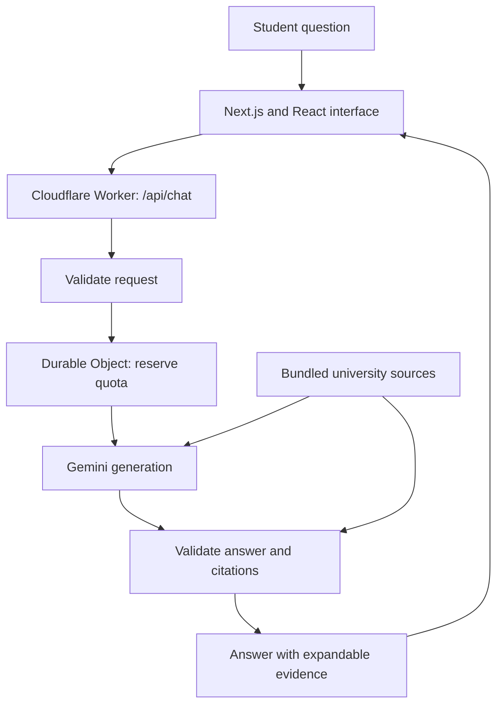

# UIT Compass

UIT Compass is a student-built university question-answering application. It helps students explore UIT academic regulations and selected general university information, with answers in English, Burmese, or a natural mix of both.

**Website:** [UIT Compass](https://uit-compass.uit-students.workers.dev/)

This guide explains how the project was developed, from preparing documents to deploying a grounded AI chat on Cloudflare. Other developers can adapt these steps to their own institutions. Answers support understanding; official academic decisions and current admissions requirements should be confirmed with UIT.

## Architecture

The interface uses Next.js and React. For deployment, it is exported as static assets served by a Cloudflare Worker. The Worker also handles `/api/chat`, calls Gemini, validates responses, and returns source details. A SQLite-backed Durable Object coordinates request quotas. A Next.js server does not run on Cloudflare in this project.



| Component | Implementation | Purpose |
| --- | --- | --- |
| Interface | Next.js App Router, React, CSS | Responsive multilingual chat |
| Hosted API | Cloudflare Workers | Server-side credentials and generation |
| AI provider | Gemini REST API | Answers from supplied evidence |
| Knowledge | Markdown regulations and JSON general records | Inspectable, attributed source material |
| Shared quotas | SQLite-backed Durable Object | Persistent request reservations |
| Verification | Node.js scripts and local Wrangler/workerd | Automated checks and integration testing |

No local AI model, vector database, or embedding service is used. The configured model is currently `gemini-3.1-flash-lite`; deployment settings are defined in [wrangler.jsonc](wrangler.jsonc).

## Step 1: Define the knowledge boundary

Start by deciding which questions the application can support. UIT Compass answers from supplied academic regulations and separately attributed general university records. Missing facts should produce an honest missing-information response rather than a guess from model memory.

For example, a graduation question can be answered from a documented CGPA requirement. An exact tuition-fee question cannot be answered when the sources contain no amount.

The API represents these differences through four statuses: `answered`, `partial`, `not_found`, and `clarification`. Uncertainty is therefore part of the response contract.

## Step 2: Prepare sources with traceable locations

[data/regulations.md](data/regulations.md) contains the academic source text. [lib/regulations.js](lib/regulations.js) validates metadata and sequential page markers, preserves original wording, and indexes page and section passages.

PDF page numbers and printed page numbers are separate: PDF page 14 can correspond to printed page 11. Cover and contents pages are excluded from the generation context. Section indexing retains continuations across pages, and a SHA-256 hash records source changes.

[data/general-info.json](data/general-info.json) stores history, contacts, admissions, and programme records separately. Each has an identifier, title, verification note, and caution. These records have no PDF page numbers.

[lib/knowledge.js](lib/knowledge.js) combines both source types into a versioned knowledge object. General facts supplement academic rules. Undated admissions information is marked as unverified for the current intake, and answers citing it receive a server-added notice.

**Development lesson:** preserve source identity, dates, and location before asking a model to cite evidence.

## Step 3: Create a controlled API boundary

The browser submits only the question:

```json
{ "question": "What is the minimum CGPA required to graduate?" }
```

[lib/chat-request.js](lib/chat-request.js) validates this exact shape, rejects unexpected fields and cross-origin browser requests, and enforces a 2,000-character question limit and a 12,000-byte request-body limit.

The Gemini key stays on the server. Local development uses the ignored `.dev.vars` file; deployment uses the hosted `GEMINI_API_KEY` secret. Credentials never belong in React code or a `NEXT_PUBLIC_` variable.

The local Next.js route and hosted Worker share the request parser and answering logic. Source loading and quota storage are adapted to their respective runtimes.

## Step 4: Generate structured, multilingual answers

[lib/answering.js](lib/answering.js) sends system instructions, source context, and the question to Gemini. Each request includes the full eligible context. There is no embedding search, top-k retrieval, or live web browsing.

Instructions require source-grounded answers, preserved thresholds and exceptions, and honest missing-information responses. Known variants such as `re exam`, `re-exam`, and `reexam` are normalized before generation.

The model infers language from the question: English receives English, Burmese receives Burmese, and mixed questions receive naturally mixed answers. An academic acronym alone does not necessarily make a Burmese question mixed. No language selector is needed.

Gemini returns structured JSON containing status, language, answer, and citations. Each valid request admitted by quota protection makes at most one provider call, with a 60-second timeout and a 6,000-token output ceiling. There are no automatic retries or fallback models.

**Tradeoff:** full-context generation keeps the pipeline simple but repeats input tokens. A larger corpus would need a separately evaluated retrieval strategy.

## Step 5: Validate the answer and its evidence

Structured output is checked before reaching the UI. The server validates fields, allowed statuses, language labels, text lengths, citation count, provider completion, and response size.

Each citation must identify an existing record and section. Its quote must match original source text after Unicode and whitespace normalization, and occur within the named section or its child sections. A real quote elsewhere on the same page is insufficient. Duplicate and invented citations are rejected.

Answered and partial responses require evidence. Missing-information responses have no citations and use controlled messages. Page numbers and source metadata come from server-owned records.

A targeted check also requires the adjacent exception in section 13.1.2 whenever section 13.1.1 is cited. This addresses the observed risk of presenting a deferment threshold without its qualification.

These checks establish reference existence and quote fidelity. They do **not** prove semantic correctness, complete claim coverage, or correct language selection. Human review remains necessary.

## Step 6: Connect the chat interface

[app/page.js](app/page.js) implements the UI; [lib/chat-client.js](lib/chat-client.js) handles requests and safe errors. The interface provides loading feedback, Stop, manual retry, copy actions, and expandable citations.

Only one request runs at a time. Starting a new conversation cancels the client request, and stale results cannot appear in the new conversation. Cancellation cannot guarantee that the provider has not already counted a request.

Answers render as React text, with paragraphs and lists handled by [lib/answer-format.js](lib/answer-format.js), without injecting model output as HTML. The responsive design uses white and `#007785` with readable chat typography.

Conversation history stays in browser memory and resets on reload. Each question is independent: previous messages are displayed but not sent to Gemini. Follow-up questions need their own context.

## Step 7: Reserve shared quota before generation

[cloudflare/quota-store.js](cloudflare/quota-store.js) uses one named Durable Object with persistent SQLite-backed storage. Reservations are serialized and saved before calling Gemini.

| Scope | Per minute | Per day |
| --- | ---: | ---: |
| Entire application | 3 | 100 |
| Browser session | 2 | 20 |

Failed generation and cancelled attempts consume reservations; quota-blocked requests do not. Daily counters reset at 00:00 UTC, or 06:30 Myanmar time. Blocked responses include a retry interval.

A signed HttpOnly cookie identifies a browser for throttling. It is not authentication: clearing cookies can reset session identity, while the global cap still applies. Quota state stores counters and a signing secret, not questions, answers, API keys, student identifiers, or IP addresses.

Unavailable quota storage blocks generation. Local Next.js development uses a separate file-backed store; deployment uses the Durable Object. These application counters do not cover other clients of the same Google project or guarantee provider availability or zero cost.

## Step 8: Evaluate more than connectivity

Automated tests check implementation behavior; human review checks answer quality.

| Check | Coverage |
| --- | --- |
| Sources and knowledge | Page parsing, section continuations, general metadata |
| Answering | Quotes, wrong sections, missing exceptions, malformed responses |
| Backend and client | Input boundaries, safe errors, response handling |
| Quotas | Limits, persistence, storage failures |
| Cloudflare integration | Static assets, private-file isolation, Worker API, persistence across restarts |
| Human multilingual review | Correctness, completeness, language quality, missing-information behavior |

Automated tests use simulated provider responses. The separate `test:api` connection script and real submitted questions call Gemini and consume quota.

[evaluation/questions.csv](evaluation/questions.csv) contains regulation questions, and [evaluation/review-notes.md](evaluation/review-notes.md) records review considerations. General-information questions need separate review because an expanded corpus changes which questions are answerable.

Useful cases include attendance below the threshold, internship credits, deferment exceptions, equivalent re-exam spellings, and an unspecified exact tuition fee. Passing tests does not certify all generated answers.

## Step 9: Package and deploy on Cloudflare

1. [scripts/prepare-cloudflare.mjs](scripts/prepare-cloudflare.mjs) copies frontend files and explicitly public assets into an isolated workspace. It also creates a server-only knowledge snapshot.
2. [scripts/build-cloudflare.mjs](scripts/build-cloudflare.mjs) builds the static Next.js export.
3. [wrangler.jsonc](wrangler.jsonc) defines the `ASSETS` binding, `QUOTA` Durable Object and migration, model, and request limits.
4. [cloudflare/worker.js](cloudflare/worker.js) exports the production Worker and quota class. [cloudflare/handler.js](cloudflare/handler.js) handles `/api/chat` and delegates other paths to static assets.
5. Wrangler publishes the Worker and assets. The Gemini key is configured separately as a hosted secret.
6. A real hosted question verifies provider access. The health endpoint checks configuration presence, not key validity or live provider availability.

Source text is bundled in server code, rather than exposed as a raw static file. Relevant quotes are intentionally returned as citations. Evaluation answers and secret files are excluded from the frontend build.

The frontend and API share one origin, so the browser calls `/api/chat` without a hard-coded backend hostname. Build, preview, test, and deployment commands are documented in [CLOUDFLARE.md](CLOUDFLARE.md).

## Maintaining and extending the project

To update information, edit the appropriate source, preserve attribution, update verification notes and version metadata as appropriate, review affected evaluation cases, then rebuild and deploy. Hosted knowledge is a build-time snapshot: editing a local source alone does not update the website.

Future improvements include broader multilingual review, verified current admissions records, stronger claim-to-evidence evaluation, and retrieval if the corpus grows. Persistent conversations and login would require additional design; neither is part of the current implementation.

The reusable development sequence is to prepare attributable sources, define a narrow API, generate structured answers, validate evidence, protect provider access, and evaluate real student questions. Each layer gives contributors a clear place to inspect and improve the application.
